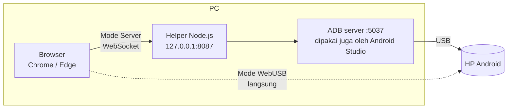

<div align="center">

# 📱 ADB Live Preview

**Mirror, kontrol, dan debug HP Android lewat USB langsung dari browser.**<br>
Seperti _Running Devices_ di Android Studio, tapi dalam bentuk web yang ringan dan latency rendah.


</div>

---

## Daftar isi

- [Fitur](#-fitur)
- [Cara kerja](#-cara-kerja)
- [Kebutuhan](#-kebutuhan)
- [Instalasi](#-instalasi)
- [Menyiapkan HP](#-menyiapkan-hp)
- [Mode koneksi](#-mode-koneksi)
- [Kontrol](#-kontrol)
- [Pemecahan masalah](#-pemecahan-masalah)
- [Self-host di server](#-self-host-di-server)
- [Konfigurasi](#%EF%B8%8F-konfigurasi)
- [Struktur project](#-struktur-project)
- [Performa](#-performa)
- [Keamanan & privasi](#-keamanan--privasi)
- [Kredit](#-kredit)

---

## ✨ Fitur

| | Fitur | Keterangan |
|---|---|---|
| 🖥️ | **Live mirror** | Video H.264/H.265 didecode di GPU (WebCodecs). Frame lama dibuang supaya yang tampil selalu frame terbaru. Bisa diatur resolusi, bitrate, dan FPS (sampai 120). |
| 🖱️ | **Kontrol penuh** | Tap, swipe, scroll, multi-touch, pinch (Ctrl + seret), keyboard dengan layout apa pun, dan sync clipboard dua arah. |
| 🎛️ | **Toolbar** | Back, Home, Recents, Power, Volume ±, Rotate, panel notifikasi, mematikan layar HP (mirror tetap jalan), screenshot, rekam layar. |
| 🔊 | **Audio** | Suara HP diputar di PC (Opus, Android 11+). |
| 📜 | **Logcat** | Format biner. Filter level, package, tag, dan regex. Pause, clear, export. Hemat memori: log di bawah level yang dipilih langsung dibuang, dan maksimal 10 ribu baris disimpan. |
| 📁 | **Device Explorer** | Browse, upload (drag & drop), download langsung ke disk, rename, hapus, buat folder. |
| 📦 | **Aplikasi** | Install APK lewat drag & drop dengan progress, buka, force stop, clear data, uninstall. |
| 🔌 | **Tanpa install di HP** | Tidak ada APK yang dipasang. Server scrcpy (90 KB) ditaruh sementara di `/data/local/tmp` dan dihapus otomatis saat sesi selesai. |

---

## 🧠 Cara kerja

Semua logika ADB dan scrcpy berjalan **di browser** (memakai library [Tango](https://github.com/yume-chan/ya-webadb)). Yang berbeda hanya jalur ke HP:



| | Mode Server | Mode WebUSB |
|---|---|---|
| Butuh install di PC | Node.js + Android Platform Tools | **Tidak ada** |
| Bisa bareng Android Studio | ✅ Ya | ❌ Android Studio / adb harus ditutup |
| Browser | Semua browser modern dengan WebCodecs | Chrome / Edge desktop |
| Cara pakai | `npm start` → buka `localhost:8087` | Buka hasil build dari HTTPS / localhost |

---

## 📋 Kebutuhan

### Di PC

| Kebutuhan | Versi | Untuk |
|---|---|---|
| [Node.js](https://nodejs.org) | **22 LTS** atau lebih baru (diuji di 24) | Build & menjalankan helper lokal |
| [Android SDK Platform Tools](https://developer.android.com/tools/releases/platform-tools) (`adb`) | terbaru | Mode Server. Sudah ikut terpasang kalau kamu punya Android Studio. |
| Google Chrome / Microsoft Edge | terbaru | WebCodecs + WebUSB |
| Internet saat `npm install` | — | Mengunduh scrcpy-server dari GitHub resmi (checksum diverifikasi) |

> [!NOTE]
> Lokasi `adb` dicari otomatis berurutan: `ADB_PATH`, `ANDROID_HOME`, `ANDROID_SDK_ROOT`, `%LOCALAPPDATA%\Android\Sdk`, `~/Library/Android/sdk`, `~/Android/Sdk`, lalu `PATH`.

### Di HP

| Kebutuhan | Keterangan |
|---|---|
| Android **5.0+** | Mirror & kontrol |
| Android **11+** | Audio |
| **USB debugging** aktif | Lihat [Menyiapkan HP](#-menyiapkan-hp) |
| Kabel USB **data** | Kabel yang cuma bisa charge tidak akan terdeteksi |

---

## 🚀 Instalasi

```bash
git clone https://github.com/rendydev404/ADB-LIVE-PREVIEW.git
cd ADB-LIVE-PREVIEW
npm install
npm start
```

Buka **http://localhost:8087**, colok HP, dan layarnya akan tampil.

| Perintah | Fungsi |
|---|---|
| `npm start` | Build production lalu jalankan helper di port 8087 |
| `npm run serve` | Jalankan helper tanpa build ulang (pakai `dist/` yang sudah ada) |
| `npm run dev` | Mode pengembangan (Vite + HMR) di port yang sama |
| `npm run build` | Build ke `dist/` saja |
| `npm run preview` | Sajikan `dist/` tanpa helper, untuk mencoba mode WebUSB |
| `npm run typecheck` | Cek tipe TypeScript |

---

## 📲 Menyiapkan HP

1. **Aktifkan Opsi pengembang:** buka **Setelan → Tentang ponsel**, lalu ketuk **Nomor bentukan** (Build number) 7 kali.
2. **Nyalakan USB debugging:** buka **Setelan → Sistem → Opsi pengembang → USB debugging**.
3. **Colok ke PC.** Kalau HP bertanya mode USB, pilih **Transfer file**.
4. **Izinkan PC ini:** tap **Izinkan** pada dialog _Izinkan USB debugging?_ dan centang **Selalu izinkan dari komputer ini**.

> [!TIP]
> Beberapa merek mengunci input dari USB:
> - **Xiaomi / POCO / Redmi:** aktifkan juga **USB debugging (Setelan keamanan)**.
> - **OPPO / realme:** aktifkan **Nonaktifkan pemantauan izin**.

---

## 🔀 Mode koneksi

### Mode Server (default saat `npm start`)

Helper lokal meneruskan byte antara browser dan ADB server, tanpa memprosesnya. Karena ADB server-nya sama dengan yang dipakai Android Studio, keduanya **bisa jalan bersamaan**. Logcat di Android Studio dan di web tetap berjalan dua-duanya.

### Mode WebUSB (tanpa install apa pun)

Kalau halaman dibuka tanpa helper (misalnya hasil build di-hosting sendiri), browser langsung bicara ke HP lewat WebUSB:

1. Klik **Tambah device USB**, lalu pilih HP di jendela browser.
2. Tap **Izinkan** di HP.
3. Pada kunjungan berikutnya, HP yang sudah diizinkan **tersambung otomatis**.

> [!IMPORTANT]
> Di mode WebUSB tidak boleh ada program lain yang sedang memakai ADB (Android Studio, scrcpy, PC Suite). Tutup program-program itu atau jalankan `adb kill-server`. Di Windows, sebagian kecil HP memerlukan [Google USB Driver](https://developer.android.com/studio/run/win-usb).

---

## 🎮 Kontrol

| Input | Aksi di HP |
|---|---|
| Klik kiri / seret | Tap / swipe |
| **Ctrl** + seret | Pinch zoom |
| Klik kanan | Back |
| Klik tengah | Home |
| Scroll mouse | Scroll |
| Ketik | Teks dikirim ke HP (mendukung semua layout keyboard) |
| **Ctrl + V** | Tempel isi clipboard PC ke HP |
| Salin di HP | Otomatis masuk ke clipboard PC |

---

## 🩺 Pemecahan masalah

<details>
<summary><b>"USB sedang dipakai program lain"</b></summary>

Kamu sedang di mode WebUSB, dan ada program lain yang memegang koneksi ADB. Tutup Android Studio, scrcpy, Vysor, atau PC Suite, lalu jalankan `adb kill-server`. Cabut dan colok ulang HP, lalu klik **Hubungkan ulang**. Alternatifnya, pakai Mode Server (`npm start`), yang bisa jalan bersamaan dengan Android Studio.
</details>

<details>
<summary><b>HP tidak muncul di daftar</b></summary>

- Cek USB debugging menyala dan kabelnya kabel data. Coba port USB lain.
- Jalankan `adb devices`. Kalau statusnya `unauthorized`, tap **Izinkan** di HP.
- Windows + WebUSB: pasang [Google USB Driver](https://developer.android.com/studio/run/win-usb) lewat Device Manager.
</details>

<details>
<summary><b>Dialog izin tidak muncul di HP</b></summary>

Nyalakan dan buka kunci layar HP, lalu cabut dan colok ulang kabelnya. Kalau tetap tidak muncul, buka **Opsi pengembang → Cabut otorisasi USB debugging**, lalu coba lagi.
</details>

<details>
<summary><b>Layar tampil tapi sentuhan tidak berfungsi</b></summary>

Lihat tips per merek di [Menyiapkan HP](#-menyiapkan-hp).
</details>

<details>
<summary><b>Layar hitam / video patah-patah</b></summary>

Perbarui browser dan pastikan **Akselerasi hardware** menyala. Di pengaturan stream (ikon ⚙️), turunkan resolusi atau bitrate, atau ganti codec ke H.264.
</details>

<details>
<summary><b><code>adb not found</code> saat <code>npm start</code></b></summary>

Pasang [Platform Tools](https://developer.android.com/tools/releases/platform-tools) atau arahkan langsung ke lokasinya:

```bash
ADB_PATH="C:/path/ke/platform-tools/adb.exe" npm start
```
</details>

---

## 🐳 Self-host di server

Hasil build berupa **file statis**. Server hanya mengirim halaman (~70 KB gzip). Video, log, dan file HP **tidak pernah lewat server**, karena koneksi ke HP terjadi lewat WebUSB di browser pengguna.

> [!WARNING]
> WebUSB hanya berjalan di **HTTPS** (atau `localhost`). Pasang reverse proxy dengan TLS di depan container.

### Docker Compose

```bash
mkdir -p /opt/adb-live-preview && cd /opt/adb-live-preview
curl -O https://raw.githubusercontent.com/rendydev404/ADB-LIVE-PREVIEW/main/deploy/docker-compose.yml
HOST_PORT=8080 docker compose up -d
```

Image `ghcr.io/rendydev404/adb-live-preview` memakai BusyBox httpd: ukurannya **3,3 MB** dan memakai sekitar **0,3 MB RAM** saat berjalan. Container berjalan sebagai non-root dengan filesystem read-only.

### Reverse proxy (Caddy)

Salin [`deploy/Caddyfile.example`](deploy/Caddyfile.example) dan ganti domainnya. Konfigurasi ini sudah menangani HTTPS otomatis, kompresi zstd/gzip, cache `immutable` untuk aset, dan `Permissions-Policy: usb=(self)`.

### Build image sendiri

```bash
docker build -t adb-live-preview .
docker run -d -p 127.0.0.1:8080:8080 --read-only adb-live-preview
```

### Auto deploy (GitHub Actions)

Workflow [`.github/workflows/deploy.yml`](.github/workflows/deploy.yml) melakukan build dan push image ke GHCR setiap ada push ke `main`. Kalau secret di bawah diisi, workflow juga me-restart container di server.

| Secret | Isi |
|---|---|
| `VPS_HOST` | IP / hostname server |
| `VPS_DEPLOY_KEY` | Private key SSH khusus deploy |
| `VPS_KNOWN_HOSTS` | Output `ssh-keyscan -t ed25519 <host>` |

Di server, batasi key tersebut supaya **hanya** bisa menjalankan [`deploy/redeploy.sh`](deploy/redeploy.sh):

```text
command="/opt/adb-live-preview/redeploy.sh",no-port-forwarding,no-X11-forwarding,no-agent-forwarding,no-pty ssh-ed25519 AAAA... github-actions
```

---

## ⚙️ Konfigurasi

Variabel lingkungan untuk helper lokal (`server/index.js`):

| Variabel | Default | Keterangan |
|---|---|---|
| `PORT` | `8087` | Port web helper (hanya mendengarkan di `127.0.0.1`) |
| `ADB_PATH` | otomatis | Lokasi `adb` |
| `ADB_SERVER_PORT` | `5037` | Port ADB server |

Untuk Docker Compose: `HOST_PORT` (default `8080`) adalah port di host yang diteruskan ke container.

---

## 🗂️ Struktur project

```text
├── server/index.js              Helper lokal: file statis + bridge WebSocket ↔ ADB server
├── scripts/fetch-scrcpy-server  Unduh scrcpy-server + verifikasi SHA-256 (postinstall)
├── src/
│   ├── transport/               Pilih mode (Server / WebUSB) dan konektor WebSocket
│   ├── device/store.ts          Daftar device, koneksi per device, info HP
│   ├── features/
│   │   ├── mirror/              scrcpy, decoder video, input, audio, rekam layar
│   │   ├── logcat/              Stream logcat biner + virtual list
│   │   └── explorer/            Device Explorer, Aplikasi, progress transfer
│   └── ui/                      Panduan, ikon, helper download
├── deploy/                      Docker Compose, contoh Caddyfile, skrip redeploy
└── Dockerfile                   Build multi-stage → BusyBox httpd
```

**Stack:** SolidJS (tanpa Virtual DOM), Vite, CSS biasa, WebCodecs, dan Tango (`@yume-chan/*`). Dependency server hanya `ws`.

---

## ⚡ Performa

Diukur pada vivo V2333 (Android 16) lewat USB:

| Metrik | Hasil |
|---|---|
| JS saat halaman pertama dibuka | ~67 KB gzip (Logcat/Files/Apps dimuat saat dibuka) |
| Request ke ADB lewat helper | ~5 ms |
| Sesi mirror siap | ~2,2 detik |
| Baca folder `/sdcard` | 20 ms |
| Daftar aplikasi | 30 ms |
| Container self-host | 3,3 MB image, ~0,3 MB RAM |

---

## 🔒 Keamanan & privasi

- **Data tetap di PC kamu.** Layar, log, dan file HP mengalir dari kabel USB ke browser, tanpa melewati server mana pun.
- **Helper lokal hanya mendengarkan di `127.0.0.1`** dan menolak koneksi WebSocket dari origin lain atau tanpa token acak per sesi. Website lain tidak bisa mengakses ADB kamu lewat `localhost`.
- **Tidak ada yang dipasang di HP.** Server scrcpy dihapus otomatis saat sesi selesai.
- **Binary scrcpy-server diverifikasi** dengan checksum SHA-256 saat diunduh.

---

## 🙏 Kredit

- [scrcpy](https://github.com/Genymobile/scrcpy) oleh Genymobile (Apache-2.0): server mirroring di sisi HP.
- [Tango / ya-webadb](https://github.com/yume-chan/ya-webadb) oleh Simon Chan (MIT): implementasi ADB dan klien scrcpy untuk browser.
